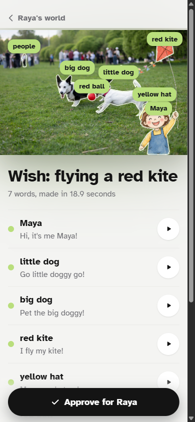
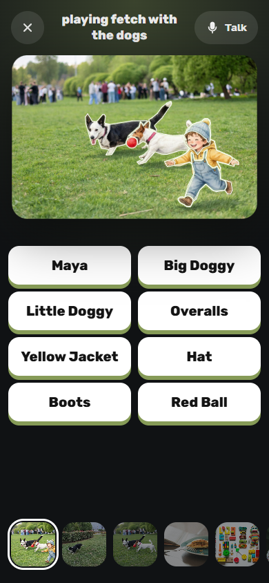
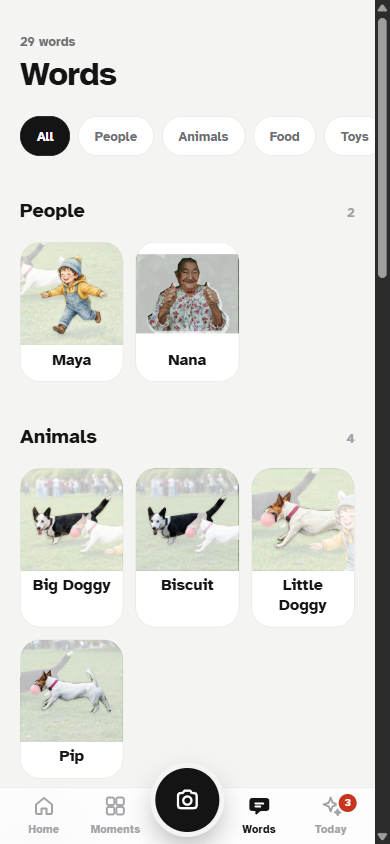
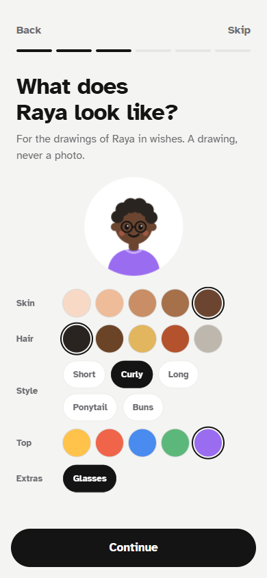
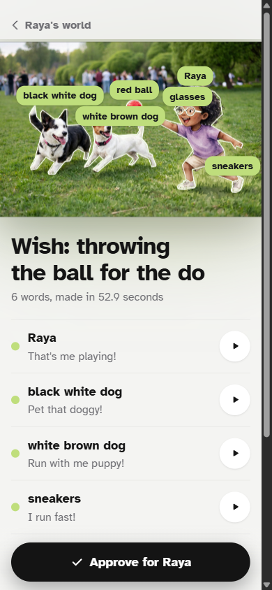
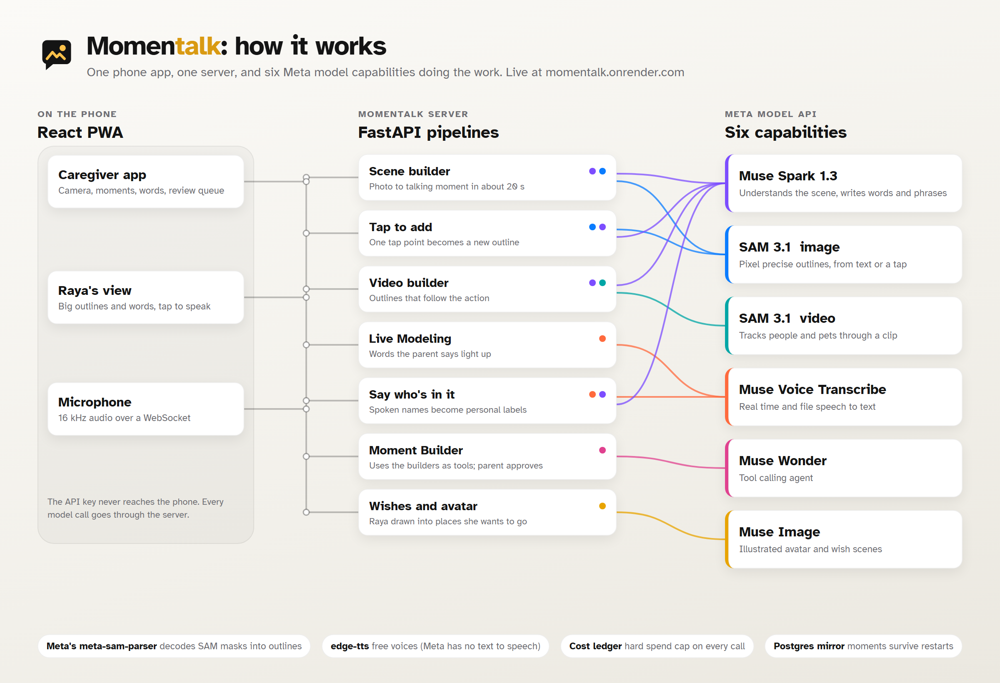

# Momentalk

**Live app: [momentalk.onrender.com](https://momentalk.onrender.com)** (open it on a phone, or in a desktop browser at phone size)

**Demo video (2:58): [youtu.be/xKECwSbhGJU](https://youtu.be/xKECwSbhGJU)**

**Every moment has a story.** Momentalk turns everyday photos into a voice for those who cannot rely on speech, making the world around them easier to express.

<p>
  
  
  
  
  
</p>

A caregiver snaps a photo of a real moment: breakfast, grandma's kitchen, the dog at the park. Seconds later every person and thing in it is outlined and speaks when tapped. The child who cannot rely on speech points at their own world, and it talks for them. When the parent talks, the words they say light up on the screen.

Built for the Meta Global AI Developer Hackathon 2026, Indie Developer track. **Everything in this repository was written during the hackathon, October 26 to November 4, 2026.**

Momentalk is a communication tool. It does not diagnose, treat, or give medical advice.

## The problem

Many people cannot rely on speech: minimally verbal autistic children, children with cerebral palsy, adults after a stroke. They communicate with AAC (augmentative and alternative communication).

One of the best supported AAC approaches for young children is the **visual scene display**: a real photo from the child's own life with "hotspots" that speak when touched. A 2024 evidence synthesis found that 12 of 14 visual scene display studies with young autistic children met every quality indicator and showed positive results [1].

The bottleneck is setup. In the commercial visual scene apps we found, a caregiver draws every hotspot by hand and types every phrase [3]. A 2025 research prototype that asked GPT-4o to propose hotspots reported that it missed objects [4]. So scenes rarely get made for the moments that matter.

The teaching strategy with large positive effects in reviews, **aided language modeling** (the partner points to the symbol while saying the word) [2], is hard for a parent to keep up all day.

## What Momentalk does

| Feature | What happens | Meta model |
|---|---|---|
| **Instant talking moment** | Snap a photo. Every meaningful person and object becomes a pixel precise outline with a word and a short phrase in the child's voice. Tap an uncovered spot to add what was missed. | Muse Spark 1.3, SAM 3.1 |
| **Talking video** | A short clip becomes a moment whose outlines follow people and pets as they move. | SAM 3.1 video tracking |
| **Live Modeling** | The parent taps Talk and speaks naturally. Words that match an outline make it glow in real time. | Muse Voice Transcribe (realtime) |
| **Say who's in it** | The parent describes the photo out loud ("the big dog is Biscuit"). Generic labels become personal names, shown for approval. | Muse Voice Transcribe, Muse Spark |
| **Moment Builder** | An agent reviews the day's photos, builds draft moments, and writes a note on which words to model, based on what gets tapped. Nothing reaches the child until a caregiver approves it. | Muse Wonder (tool calling) |
| **Wish scenes** | The child's illustrated avatar is drawn into a family photo of a place, doing something they want, so they can ask for it. Saved as a draft for approval. | Muse Image |
| **Described avatar** | In onboarding the parent describes the child (skin, hair, top, glasses). Muse Image draws an illustrated character from text only, and every wish uses it as a reference. | Muse Image |
| **Multilingual** | Words and voices follow the language chosen in onboarding. | Muse Spark, free voices |

Text to speech uses free edge-tts voices, because Meta does not offer a text to speech model.

### Safety by design

- No photo of a child is ever sent to make an avatar, and no AI image of a real child's face is generated. The avatar is built from a description.
- Everything an AI makes for the child (agent drafts, wishes) waits in a review queue until a caregiver approves it.
- The child's view has a hold to close button, so it cannot be left by accident.

## How it works



**Photo to talking moment.** Muse Spark (vision, strict JSON schema) plans up to 12 concepts with a SAM phrase, a label, a phrase, and synonyms. SAM 3.1 segments each phrase in parallel. Masks arrive range coded and are decoded with Meta's official `meta-sam-parser`, unioned for groups ("blocks"), deduplicated by IoU, filtered (no backgrounds, nothing over 35 percent of the photo unless it is a person), and turned into simplified polygons. Every phrase is voiced and cached. About 20 seconds end to end.

**Tap to add.** The tap point goes straight to SAM 3.1 as a point prompt; Spark names the result.

**Video.** ffmpeg trims and downscales the clip, Spark picks trackable people, pets and toys from three sampled frames, SAM 3.1 tracks them with stable identities, and the browser interpolates outlines against `video.currentTime`.

**Live Modeling.** The browser streams 16 kHz PCM over a WebSocket to the backend, which proxies Meta's realtime ASR (the key never reaches the browser). Partial transcripts go through a local matcher (labels plus Spark synonyms, normalized), so a heard word lights up about 2 seconds after it is spoken.

**Moment Builder.** A Muse Wonder tool calling loop (`list_todays_media`, `look_at_media`, `get_tap_stats`, `build_draft_moment`, `finish`) with a hard step limit. Its trace is shown live in the Today tab.

**Persistence.** The app works on files. When `DATABASE_URL` is set, the whole data folder is mirrored into Postgres every few seconds and restored on boot, so moments survive restarts on free hosting.

**Spend guard.** Every Meta call goes through a cost ledger with a hard cap. The public demo also rate limits model work per visitor and keeps the sample moments read only.

## Run it locally

Requirements: Python 3.11+, Node 20+, ffmpeg, and a Meta Model API key.

```bash
cp .env.example .env                 # add MODEL_API_KEY
python -m venv .venv
.venv/Scripts/pip install -r backend/requirements.txt     # on macOS or Linux: .venv/bin/pip

cd backend
../.venv/Scripts/python -m uvicorn app.main:app --port 8000

cd ../frontend
npm install
npx vite --port 5173
```

Sample moments: `cd backend && ../.venv/Scripts/python -m app.seed --build` outlines the demo photos with Spark and SAM.

Tests: `cd backend && ../.venv/Scripts/python -m pytest` (the Postgres round trip test runs when `MOMENTALK_TEST_DATABASE_URL` is set).

Deploy: one Docker container (`Dockerfile`, `render.yaml`) plus an optional free Postgres (`DATABASE_URL`).

## Built during the hackathon

All code, the design, the logo, and the sample moments were made between October 26 and November 4, 2026. Highlights by day are in the git history. The `spikes/` folder keeps the first API experiments for honesty.

## Research

1. Patenaude, McNaughton and Liang (2024). Using visual scene displays with young children: an evidence based practice synthesis. [PDF](https://bpb-us-e1.wpmucdn.com/sites.psu.edu/dist/0/186605/files/2025/04/patenaude-et-al-2024-using-visual-scene-displays-with-young-children-an-evidence-based-practice-synthesis.pdf)
2. Sennott, Light and McNaughton (2016). AAC modeling intervention research review. [ASHA Evidence Map](https://apps.asha.org/EvidenceMaps/Articles/ArticleSummary/382d4ec1-3574-4ca4-b986-530e8ade36cb). See also O'Neill, Light and Pope (2018), [PubMed](https://pubmed.ncbi.nlm.nih.gov/30198767/).
3. Commercial visual scene apps with manual hotspots: [Scene and Heard](https://prc-saltillo.com/blog/scene-heard-launch), [Scene Speak](https://www.goodkarmaapplications.com/scene-speak1.html).
4. AI generated visual scene displays for pre-service SLPs (2025), [arXiv 2507.21811](https://arxiv.org/pdf/2507.21811).
5. Visual scene displays for people with aphasia: [AAC Learning Center](https://aac-learning-center.org/2017/10/01/aac-for-aphasia-a-review-of-visual-scene-displays-project/), [ASHA AJSLP](https://pubs.asha.org/doi/10.1044/2021_AJSLP-20-00229).

## Credits

Demo photos from Unsplash and one video from Pexels, each credited in [docs/ASSETS.md](docs/ASSETS.md). No real child appears anywhere in the app or the demo.

## License

MIT
