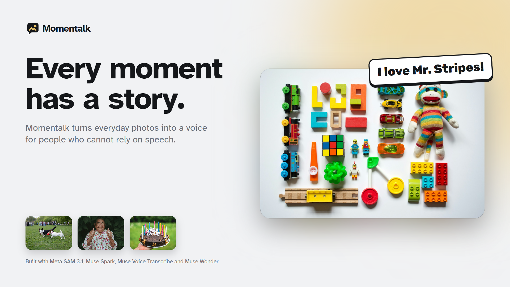
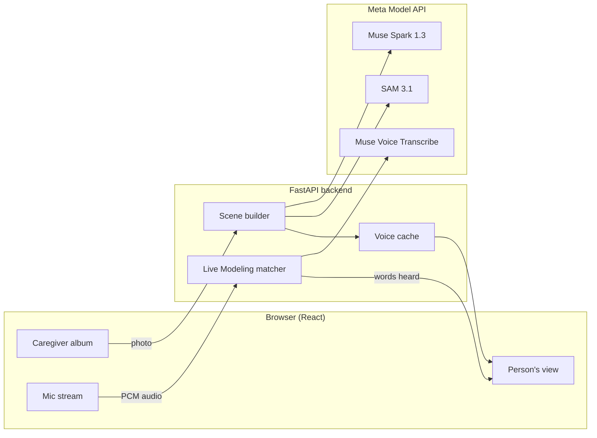

# Momentalk

**Every moment has a story.** Momentalk turns everyday photos into a voice for people who cannot rely on speech.



A caregiver snaps a photo of a real moment: grandma in the kitchen, the dog at the park, the toy box. In seconds, every person and thing in it becomes an outlined button that speaks when tapped. The person who cannot rely on speech points at their own world, and it talks for them.

Built for the Meta Global AI Developer Hackathon 2026 (Indie Developer track). Everything in this repository was built during the hackathon, October 26 to November 4, 2026.

## Why

Visual scene displays (a real photo with tappable "hotspots") are one of the best supported communication supports for young children who are minimally verbal and for adults with aphasia. A 2024 evidence synthesis found 12 of 14 studies with young autistic children met every quality indicator and showed positive results. The problem is setup: caregivers have to draw every hotspot and type every phrase by hand, so scenes rarely get made for the moments that matter.

Momentalk removes that work with Meta's models.

Momentalk is a communication tool. It does not diagnose, treat, or give medical advice.

## How it uses Meta's models

| Meta model | What it does in Momentalk |
|---|---|
| **SAM 3.1** | Outlines every person and object as a pixel precise, tappable hotspot. Tracks hotspots through video so they follow people as they move. Tap anywhere to add a missed object with a point prompt. |
| **Muse Spark 1.3** | Reads the photo and decides what is worth talking about, writes the label and a short first person phrase for each thing, and tells SAM what to look for. |
| **Muse Voice Transcribe** | Live Modeling: when a parent talks, the words they say light up on the board in real time (aided language modeling, the strongest evidence based teaching strategy in this field). Also turns a caregiver's spoken description into personal labels ("This is Nana"). |
| **Muse Wonder** | Moment Builder agent: reviews the day's photos, proposes new scenes, and suggests words to model. Nothing reaches the person until a caregiver approves it. |
| **Muse Image** | Wish Scenes: places and activities that are not in front of the person, so they can ask for them. |
| **Muse Spark Open** | Private Mode: language work runs on open weights through partner inference. |

Text to speech uses free edge-tts voices, because Meta does not offer a text to speech model.

## Architecture



## Run it locally

Requirements: Python 3.11+, Node 20+, ffmpeg, a Meta Model API key.

```bash
cp .env.example .env        # add MODEL_API_KEY
python -m venv .venv
.venv/Scripts/pip install fastapi "uvicorn[standard]" httpx python-dotenv websockets edge-tts pillow numpy opencv-python-headless python-multipart pytest

cd backend
../.venv/Scripts/python -m app.seed --build      # outline the demo moments with Spark and SAM
../.venv/Scripts/python -m uvicorn app.main:app --port 8000

cd ../frontend
npm install
npx vite --port 5173
```

Tests: `cd backend && ../.venv/Scripts/python -m pytest`

## Credits

Demo photos from Unsplash, credited in [docs/ASSETS.md](docs/ASSETS.md). Research sources are listed in the same document set.

## License

MIT
